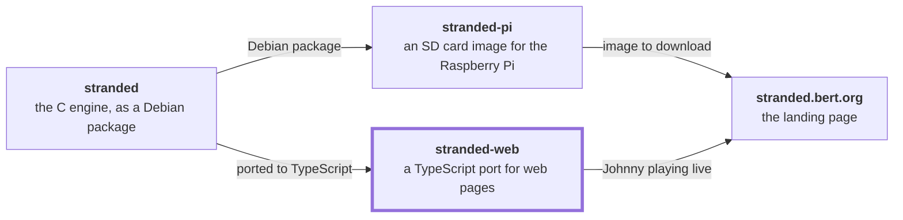

# stranded-web



[stranded](https://github.com/bertrandom/stranded) · [stranded-pi](https://github.com/bertrandom/stranded-pi) · [stranded-web](https://github.com/bertrandom/stranded-web) · [stranded.bert.org](https://github.com/bertrandom/stranded.bert.org)

Johnny Castaway, the 1992 screen saver, on a web page.

It's a TypeScript port of [stranded](https://github.com/bertrandom/stranded)'s engine, itself a fork of Jérémie Guillaume's [Johnny Reborn](https://github.com/jno6809/jc_reborn), drawing on a `<canvas>`. Like stranded on a widescreen display, it can widen the picture to fill its space: the open ocean scenes extend their ocean and sky to the edges. [stranded.bert.org](https://stranded.bert.org) uses it.

## Using it

    npm install
    npm run build

Then, from a page's project, add it as a dependency (eg. `"stranded-web": "file:../stranded-web"`), and make the data (see below). The page sizes an element, and the player fills it:

```html
<div id="johnny" style="width: 640px; aspect-ratio: 4 / 3"></div>

<script type="module">
  import { createPlayer } from 'stranded-web';

  const player = await createPlayer(document.getElementById('johnny'), {
    data: 'data/',
  });
</script>
```

### Options

| Option | Default | |
| --- | --- | --- |
| `data` | | URL of the data folder, relative to the page |
| `shape` | `'fill'` | `'fill'` widens the picture to the element's shape (up to 4:1) and covers it. `'4:3'` keeps the original picture, letterboxed if needed |
| `intro` | `true` | Start with the title screen, as the original does. With `false`, Johnny's straight on the island |
| `controls` | `true` | A control bar: pause, next scene, sound, full screen, and the day of the story |
| `caption` | `true` | What's playing, eg. "Day 3 · Fishing", in the control bar |
| `keyboard` | `true` | Keys while the player has the focus: Space pauses, Return steps a frame while paused, N skips to the next scene, M toggles max speed, F goes full screen |
| `autoHide` | `3000` | How long without moving the pointer before the control bar fades out, in ms, or `false` |
| `sound` | `false` | Whether sound is on, until the visitor changes it. Browsers only play it after a click or a key press on the page |
| `rememberSound` | `true` | Remember the visitor's choice of sound in the browser |
| `onNowPlaying` | | Called with what's on screen at each change: the activity (`'intro'`, `'scene'` or `'walk'`), the ADS script and tag, the day of the story, and `title`, in words |

`createPlayer()` resolves once the data has loaded and Johnny has started. The player it returns has `play()`, `pause()`, `togglePause()`, `step()`, `nextScene()`, `toggleMaxSpeed()`, `setSound()`, `setStoryDay()` and `toggleFullscreen()`, and `paused`, `soundEnabled` and `storyDay`.

There can only be one player on a page. The story's progress, a day at a time over eleven days, is kept in the browser's local storage.

A `'fill'` player follows its element's shape from one round of scenes to the next: until then, the picture is scaled to cover it.

## The game's data

The original game's data files aren't included. `stranded-extract` (`npm run extract --` in this repository) reads `RESOURCE.MAP`, `RESOURCE.001` and the `sound*.wav` files (the same ones stranded uses, see [its README](https://github.com/bertrandom/stranded#data-files)), and writes what the player loads, by default to `public/data`:

    npx stranded-extract <directory with RESOURCE.MAP> [output directory]

| File | What |
| --- | --- |
| `manifest.json` | The palette, the ADS and TTM scripts (uncompressed), and where each sprite is in its sheet |
| `scr/*.png` | The backgrounds |
| `bmp/*.png` | The sprites, one sheet per BMP |
| `sounds/*.wav` | The sounds, as they are |

The PNGs are 4-bit with the game's 16-color palette, so they hold the original pixels exactly; the player decodes them itself rather than through a canvas, which could alter colors. About 1.6 MB in all. Served from another origin, they need CORS.

## Examples

    npm run extract -- <directory with RESOURCE.MAP>
    npm run dev

[examples](examples) has three pages:

- [4x3](examples/4x3/index.html): the original picture, with controls, in a blank page
- [full-width](examples/full-width/index.html): across the window, widening the ocean, as on a landing page
- [no-controls](examples/no-controls/index.html): the whole window and nothing else, like a screen saver

## How the port is organized

`src/engine` follows stranded's C files: `ads.ts`, `ttm.ts`, `graphics.ts`, `island.ts`, `walk.ts` (with `calcpath.c`), `story.ts`, `sound.ts` and `events.ts`. `src/data` holds the tables from its `*_data.h` headers. The C engine waits in blocking loops; here, the loops are `async` and waiting yields to the browser, so the structure stays the same. SDL's surfaces become `Surface` (`surface.ts`), with the same clipping and color key behavior. `src/player.ts` is the part a page uses.

What's left out, being for the Pi: the web server and API, night mode, and the settings file.

## License

GPL v3 or later, as stranded and Johnny Reborn.
